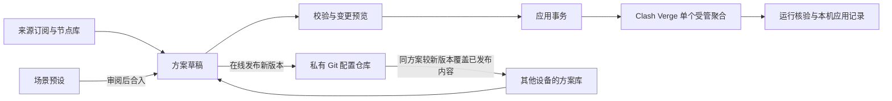
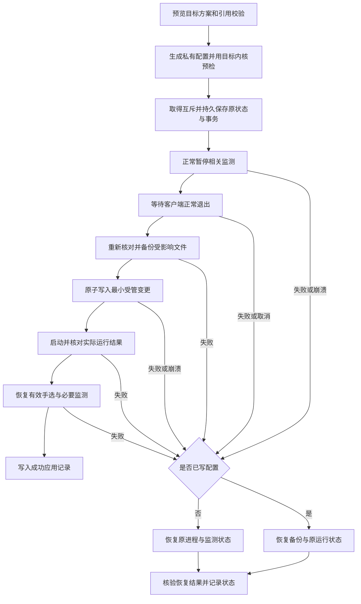

# 独立订阅配置管理器：设计与实施方案

- 状态：复核版设计基线，24 项访谈选择已确认；本次归档方案文档，软件实现另行启动。
- 日期：2026-10-21。
- 结论依据：[访谈记录](subscription-manager.md)、[领域词汇](../../GLOSSARY.md)、[架构决策](../adr/0001-companion-configuration-manager.md)。
- 技术栈：[Electron + React + TypeScript/Node.js](../adr/0005-typescript-product-core.md)，正式发行不依赖 Python。
- 交付：Windows 便携包，手动升级，用户配置与程序目录分离。

## 1. 产品定位与首版闭环

独立软件集中管理来源订阅、节点库、多套聚合方案、场景与策略组，将选择的方案应用到 Clash Verge。Clash Verge 继续承担代理内核、TUN 和系统代理。

首版面向个人多设备使用，工程目标为 Windows x64；在此基础上逐步完善为可供其他用户使用的产品。程序运行不依赖本代码仓库；开发代码集中在本仓库，个人配置通过迁移向导导入。

首版验收覆盖完整链路：识别现有订阅 → 迁移为 `default` → 拖拽调整 → 预览差异 → 应用并核验 → 发布方案 → 另一台设备获取、绑定本机来源并应用。

图中发布、获取和本机应用是三个独立动作。发布成功不代表本机已应用，获取成功也不触发代理切换。

## 2. 已确认的产品行为

| 范围 | 行为 |
|---|---|
| 来源订阅 | 首次读取 Clash Verge 已导入订阅，统一提供新增、刷新、停用、删除入口 |
| 来源库 | 所有方案共用订阅和节点库，真实凭据分别留在设备本机 |
| 多方案 | 初始只有 `default`，支持新建、复制、保存和选择方案，各方案独立维护配置 |
| 生效入口 | Clash Verge 中保留一个受管“订阅聚合”，明确应用才切换当前方案 |
| 节点成员 | 仅使用明确选入的固定成员；新增节点提示待选，不自动进入聚合或代理组 |
| 节点失效 | 删除或改名保留失效标记，人工重新绑定或移除；超时只标记健康状态 |
| 场景与策略 | 场景划分流量，策略组选择出口，多场景可复用策略组 |
| 拖拽 | 多选节点、批量拖入、引用其他组、调整顺序；禁止循环引用 |
| 常规策略 | 手选、测速优选、按顺序故障转移均可自由创建 |
| 动态稳定 | 迁移现有稳定池的行为，首版保留其专用范围 |
| 删除依赖 | 展示所有受影响引用，集中替换或移除；空组、无效路由阻止应用 |
| 场景预设 | 记录来源与版本，更新展示差异，经审阅后合入并保留自定义内容 |
| 刷新 | 手动及托盘定时刷新；兼容的节点数据更新可自动生效，结构变化留待应用 |
| 同步 | 软件封装私有 Git 上传与获取，同一方案由较新正式版本覆盖较旧版本 |
| 外部修改 | 受管结构和规则偏离时提示；可导入草稿，否则下次应用恢复软件方案 |
| 本机状态 | 端口、TUN、当前选择、健康状态和应用方案分别由每台设备记录 |

## 3. 数据模型与保存位置

本节是基于已确认需求的工程细化，随整体方案确认。

| 对象 | 核心内容 | 保存范围 |
|---|---|---|
| 来源目录 | 稳定来源标识、显示名、可共享描述 | 共享设计 |
| 本机来源绑定 | 来源标识与本机订阅 UID 的映射、私有连接信息 | 本机 |
| 节点库 | 本机获取的节点及可展示属性、刷新结果 | 本机私有快照 |
| 方案 | 稳定方案标识、名称、来源参与关系、聚合成员、组、场景和规则 | 共享设计 |
| 节点引用 | 来源标识与原始节点名称，不包含服务器、密码等连接字段 | 方案内容 |
| 方案草稿 | 可编辑内容、基于哪个正式版本、本地恢复快照 | 本机 |
| 已发布方案 | 正式版本号、内容摘要、更新说明及不可变快照 | 私有 Git |
| 本机应用记录 | 方案标识、正式版本或草稿摘要、受管文件摘要、部署及核验结果 | 本机 |

- 来源、方案、组、场景均以稳定标识引用，显示名称可修改；不能因为改显示名称而重新绑定到另一对象。
- 节点先按“稳定来源标识＋原始名称”对应；同一来源重名属于歧义，不能自动合并。改名按已确认规则显式重新绑定。
- 方案另存固定聚合成员清单；组引用的节点必须属于该方案聚合成员。拖入来源节点时可一并明确加入聚合；移出聚合前检查组引用。
- 搜索和筛选只帮助当前多选，批量拖入保存当时的明确成员，不保存自动扩容条件。
- 共享数据使用带 `schemaVersion` 的 JSON，数组保留有意义的顺序；内容摘要使用稳定序列化。文件格式版本、软件版本和方案版本分别管理。
- 非敏感用户配置放入独立用户数据目录；订阅 URL、节点凭据、原始响应、私有暂存和部署备份遵守仓库约束，只留在本机 Clash Verge 管理目录。Git 同步使用字段白名单。
- 设备缺少某来源时仍能保存和查看收到的方案，明确标记待绑定；实际应用前必须补齐其使用的来源与成员。
- 方案结构摘要、来源私有快照摘要及热刷新收据分别记录；正常节点刷新只更新本机数据记录，不制造方案新版本，也不误报为外部修改受管结构。

## 4. 界面与日常操作

- 顶部：方案选择、当前编辑方案、远端版本、本机已应用方案与状态；保存、上传、获取、预览、应用相互区分。
- 左侧：来源订阅与节点库，展示刷新状态、可用信息、新增待选、失效对应，提供搜索和多选。
- 中间：场景、策略组及成员卡片，支持批量拖入、组引用和顺序调整；共享策略修改时展示受影响场景。
- 右侧：所选对象的配置与引用关系；类型不同只显示相关选项。
- 关系图：辅助检查“规则／场景 → 组 → 节点”的引用链，使用与实际方案相同的数据模型。
- 应用面板：展示新增、移除、改名、规则顺序、依赖问题、是否需要退出客户端及核验结果。
- 历史与恢复：查看方案发布历史和本机部署记录，区分配置历史与设备备份。

DIRECT、REJECT 作为显式内置目标参与配置，不在空组或异常时自动补入。迁移后仍保留现有 AI／社交等场景限制；调整限制应成为用户可见的草稿变更。

## 5. 订阅与节点更新

### 首次接入与迁移

- 只读发现客户端与配置目录，校验程序身份、索引结构和兼容版本；唯一有效配对可自动采用，存在歧义时由用户选择。
- 读取实际来源卡片及节点缓存，迁移现有聚合配置为 `default`，保留组名、规则、专属线路名单、排除项、策略顺序和有效默认项。
- 当前全量池展开为迁移时的固定名单，后续新节点不自动纳入。已有排除项仍作为明确的成员限制保存。
- 首次接管前展示受管文件、来源绑定和旧同步入口影响；同一聚合配置只允许一个配置权威源。旧工具不能继续反向覆盖新软件方案。
- 接管不是仅新增一个旧工具不认识的 owner 字段：现有旧入口会优先信任 `config-sync/repository.json` 的 UID 与绑定。工程方案是保留现有聚合入口 UID、分配新的专属 Merge／Script UID，保留已备份的旧扩展与旧记录作为兼容拒绝依据，使旧入口因绑定不一致而停止；新 Script 不冒充旧 `aggregatePolicy` 识别特征。需隔离验证受支持旧入口的有记录及回退识别路径均拒绝覆盖，无法证明时停止接管。
- 接管、应用与恢复使用设备互斥，并兼容已有 `repository.lock`／`import.lock` 的互斥协议，避免新旧进程并发写入。归属转换与扩展绑定变化纳入同一事务；反向交还须显式恢复并核验旧绑定，不能删掉归属标记就允许双方继续写。
- 首版建立明确的 Clash Verge、Mihomo 版本及索引格式兼容表。未知写入结构或缺少必要能力时只读展示并说明原因，不能尝试猜测格式后写入。
- 原有其他 profile 和全局扩展保留；修改已有绑定或文件前先完成对应备份与校验。

### 新增、停用和删除

- 新增来源先获取、解析并展示节点，选择加入哪些方案和成员；落到 Clash Verge 的卡片或绑定变更进入待应用事务。
- 方案内停用来源只改变该方案的参与关系，须一并处理依赖，不删除全局来源或其他方案内容。
- 全局删除来源列出所有方案引用；替换或移除依赖后才可发布、应用相关改动。删除本机来源卡片的范围在确认界面明确展示。
- 本机解绑／删除卡片与共享来源的全局删除分别表达；本机缺少凭据不能被同步成全局删除。全局删除发布前须读取远端完整方案与来源目录，验证所有引用；离线可以保存删除草稿，不能宣称共享删除已经完成。
- 删除组或场景同样先处理引用，不级联清空其他场景。当前生效方案的删除须先选择有效替代方案并应用。

### 刷新与生效分层

- 默认继承已有订阅刷新周期，缺少有效周期时使用现有聚合的两小时基线，并允许在界面调整；手动刷新随时可用。
- 软件先在本机私有暂存获取并解析新快照；失败不覆盖最后有效数据，节点健康检查失败不视为成员删除。
- 来源刷新沿用已确认的下载参数，并记录快照来源。Clash Verge 原卡片仍可能自行更新；软件只读吸收通过校验的新缓存，不与客户端并发改写原卡片、索引或绑定。聚合热刷新只写明确受管的私有 provider 文件，原卡片落盘变更遵守退出后的事务。
- 来源节点库可以展示新节点；运行聚合使用方案的固定名单。工程建议由软件生成受控的本地 provider 文件，避免上游新增节点直接扩充运行候选。
- [Mihomo 文档](https://wiki.metacubex.one/config/proxy-providers/)支持文件 provider，[控制接口](https://wiki.metacubex.one/api/)支持更新已加载 provider；具体热刷新行为必须用目标内核实测后启用。
- 成员与结构不变、兼容验证通过的连接数据更新：备份受影响私有文件，更新受控 provider 并核验。失败恢复旧文件和运行状态。
- 热刷新与应用共用设备级写互斥，提交前重新核对当前生效方案、成员及快照基线；不能把针对旧方案准备的刷新结果写入刚切换的新方案。
- 节点缺失、改名、引用失效、来源地址编辑或结构变化：标记待处理／待应用，不自动替换节点或切换场景出口。
- 来源卡片同步与内核 provider 更新分别由适配模块处理；缺少安全的在线卡片更新路径时，原卡片落盘更新留待客户端退出后的事务。
- 界面分别说明“已获取”“待应用”“已生效”，不能把下载成功显示为 Clash Verge 已加载。
- 来源提供的流量、到期和刷新时间等元信息单独记录来源及获取时点；未提供时显示“未知”，获取失败保留上次成功值并标记陈旧，不显示为零或刚刚更新。原卡片元信息需要回写时进入相应安全事务，不因 provider 已刷新就声称卡片元信息已同步；这些元信息不参与方案版本比较。

## 6. 场景与规则

- 首批从现有已维护场景整理：AI、社交、TikTok、Google、Steam、港台番剧、国际媒体和 Telegram；保留现有默认行为，再允许用户在界面修改。
- 预设记录来源、版本、规则内容及用户覆盖。第三方订阅仅解析可识别规则数据，不执行其 Script 或把整份订阅配置自动接管到聚合。
- 首次迁移遇到不支持的规则类型、缺失规则集合依赖或依赖动态脚本的内容时列出具体未迁移项；影响既有分流则阻止接管，不能静默丢弃后显示完整迁移成功。
- 新预设或预设更新进入审阅界面，用户选择接受的变化；保留自定义规则和明确修改，不自动覆盖。
- 规则顺序：必要直连例外 → 自定义规则 → 场景预设 → 剩余基础规则 → 默认出口。专属服务规则先于宽泛分类。
- 允许编辑受支持的域名、IP、进程等规则。同一优先层内，相同匹配条件指向不同目标且没有明确顺序时阻止应用；跨层的合法自定义覆盖按已确认优先级确定结果、去重并展示被覆盖规则，不能把正常自定义覆盖误报为冲突。可能遮挡的宽泛规则给出解释。
- 命中预览使用同一编译结果，展示首条命中及出口引用链；需要 DNS、进程等上下文而输入不足时明确说明，不能推断真实连接结果。

## 7. 多方案版本与 Git 同步

- 每套方案独立使用 `YYYY.MM.DD.序号`，按数字段比较，例如 `.10` 大于 `.2`。方案名称不作为唯一身份。
- 发布时读取远端最新合法状态，日期取当前本机日历日期与该方案最新正式日期中的较大值；同日序号递增，设备时钟回拨也不能生成低于远端的版本。
- 以最新远端提交为基线，仅替换本次发布的方案并保留其他方案；普通条件推送失败则重新读取、取号并重建提交，有界重试，不强推覆盖 Git 历史。
- 每次发布保存稳定的请求标识与目标快照。推送结果因断网等原因不确定时，先核对远端历史是否已包含该请求；已成功的请求不再次取号发布，也不因重复重试覆盖其后其他设备的新版本。
- 上传整份方案，不自动合并两个设备对同一方案的内容。较晚发布的旧草稿会形成较高新版本，可能替换他人此前修改；历史保留。
- 同版同摘要为一致；同版异摘要、历史版本被改写、未知数据格式或摘要不符时停止同步。
- 获取时只在同方案中比较版本，较新正式内容覆盖本机已发布方案头；未发布草稿先存本机恢复快照，再载入新版本，不把草稿时间当正式版本。
- 获取、发布均不自动应用；本机使用哪个方案及哪份内容，以最后成功应用记录为准。
- 全局来源目录有独立修订和摘要。目录删除若影响方案，相关方案修订和目录变更作为同一发布事务处理；不能因上传一套方案而删掉其他方案或来源。
- 来源目录按本次明确的增改删操作更新最新远端状态，不用旧设备的整份旧目录覆盖。来源删除同样保留删除记录；旧草稿引用已删除来源时停止发布并提示修复，重新加入需显式操作，不能因为方案版本较高而静默复活来源。
- 方案删除保留可同步的删除记录，避免旧设备重新上传而意外复活；本机恢复或恢复历史方案内容时创建草稿，正式共享恢复应发布更高版本。
- 首次同步需要配置已有私有仓库和完成身份认证；软件封装 Git 操作并随包交付必要工具，认证可接入 SSH 或系统凭据机制。零开发环境不等于零账号配置。
- Git 只承载白名单数据，不从配置仓库拉取或执行程序、扩展脚本和构建命令。

## 8. 应用、恢复与成功标准

应用事务是一个深模块，界面提交目标方案即可；备份、顺序、锁、恢复及成功凭证集中由该模块管理。

- 开始写入前取得设备级互斥，事务持久记录足以在进程崩溃、断电或下次启动时识别未完成阶段。
- 在暂停监测前即持久保存客户端原运行状态、原当前 profile、有效手选、受管文件与绑定基线，以及监测原存在／运行／启用状态和任务归属；持久化失败不得继续暂停或退出。不能等配置写入后才建立恢复依据。
- 每个副作用先记录意图，执行后核对并记录完成阶段；崩溃恢复依据实际状态幂等补偿，恢复未完成时阻止新写入事务继续叠加。
- 监测暂停、用户取消退出、退出超时和备份失败也属于需补偿的阶段。尚未写配置时只恢复本次实际改变的进程与监测状态；已经写配置时才使用经校验的文件备份恢复，不能调用不存在的备份。
- 内核预检先执行；客户端仍在运行且没有受支持的正常退出接口时，首版提示用户手动从托盘退出，确认进程结束后继续。关闭窗口、强杀和模拟托盘点击不作为正常退出替代。
- 修改本机已有文件、绑定或缓存前备份并校验；备份失败停止。只修改明确受管项，保留设备字段、无关订阅与全局设置，不直接编辑生成的 `clash-verge.yaml`。
- 客户端退出后重新核对磁盘最终状态，防止退出时保存的选择或刷新结果被旧快照覆盖。
- 恢复以最后实际生效的原方案为基线，按原运行／启用状态恢复监测，重新评估动态优先值；不盲目回写旧动态 `fixed`。若已启动新方案监测，先正常停止后再恢复旧方案。恢复前发现本次事务以外的后续修改时停止覆盖，显示需处理的状态。
- 比较 `/proxies`、`/providers/proxies`、`/rules` 及有效 `now/fixed`，核对组类型、候选范围、顺序、规则首条命中和当前聚合入口。
- 组的稳定标识与改名映射用于恢复有效手选；失效选择明确提示处理，不能恢复到不存在的节点或自动扩大候选。
- 只有文件应用、实际运行核验、必要选择恢复与监测恢复全部通过，才写入成功凭证。网站、账号和 TUN 体验另行验证。
- 相同内容且运行核验通过时复用结果，避免无意义重启；应用失败尽力恢复并核验，恢复失败显示明确状态和本机备份位置。
- 恢复设备备份不改写远端最新方案；共享配置回退通过发布更高版本表达。

## 9. 程序结构与后台生命周期

| 模块 | 小接口承担的职责 | 实现约束 |
|---|---|---|
| 领域核心 | 校验方案、计算依赖影响、编译目标配置、比较版本、评估稳定池 | 普通 TypeScript，不导入 Electron 或 Windows 功能 |
| 方案存储 | 保存草稿、读取快照、执行数据格式迁移 | 草稿恢复、发布快照与应用记录分开 |
| 共享发布 | 发布方案、获取较新方案 | 隐藏 Git 提交、并发取号和来源目录一致性 |
| Clash Verge 适配 | 读取本机来源、准备受管变更、查询偏离 | 文件格式与客户端版本知识集中，不暴露给界面 |
| 应用事务 | 预览、应用、恢复、恢复未完成事务 | 统一备份、锁、写入、运行核验与凭证 |
| 后台执行 | 订阅刷新、稳定池监测和安全停止 | 与界面渲染隔离，显式管理任务生命周期 |
| Windows 本机 | 程序识别、进程状态、互斥、登录任务等 | 必要辅助程序随包交付，正式用户无需安装 Python／PowerShell 开发环境 |
| Electron 桌面 | 窗口、托盘、受限进程通信与本机对话框 | React 通过白名单命令操作，不直接访问凭据或任意文件路径 |

模块接口也是测试入口，时钟、文件系统、控制器和远端交互提供可替换的实际或测试适配；避免为未确定的平台或插件体系提前铺设抽象层。

- 窗口关闭到托盘：继续已启用的订阅刷新和监测。
- 显式退出管理器：停止管理器的订阅刷新；正在应用时先完成或安全恢复事务，再退出。
- 为保留既有独立稳定监测，迁移已经启用的登录任务为随包程序的无界面后台模式；它有独立状态、锁和明确停止入口，不依赖 Python 或渲染窗口存活。新设备未启用监测时不擅自创建运行任务。
- 停止稳定监测时正常清理动态优先值、恢复静态回退；切换到不含对应稳定池的方案时停止该监测，不让旧任务改写其他组。
- 后台程序与管理器使用同一份 TypeScript 实现和版本校验；便携目录移动或升级时重新验证任务目标，不能遗留指向旧仓库的任务。
- 崩溃不能依赖退出回调清理；使用持久事务与下次启动恢复，并防止新旧监测同时控制稳定池。

## 10. 实施顺序与阶段验收

阶段是工程推进顺序；首版交付需完成全部闭环。

| 阶段 | 交付 | 验收重点 |
|---|---|---|
| 1. 核心与兼容探针 | 数据结构、领域校验、确定性编译、客户端只读识别、脱敏迁移样本 | 不改活动配置，迁移固定成员、规则首条命中及组引用一致 |
| 2. 本机事务 | 归属转换、最小受管文件生成、备份、互斥、恢复、正常退出等待和核验 | 注入暂停后取消、退出失败、备份失败、写入中断、启动失败、后续修改及崩溃，结果可解释且可恢复；误开旧入口不覆盖 |
| 3. 可视化编辑 | 来源库、多方案、卡片拖拽、策略参数、规则编辑、预览与应用 | 多选、排序、共享引用、依赖删除和失效处理均通过同一领域校验 |
| 4. 刷新与监测迁移 | 来源生命周期、私有快照、已验证热刷新、TypeScript 稳定池监测 | 新节点不自动入组，缺失不替补，停止清理与现有决策契约一致 |
| 5. 私有 Git 与发行 | 在线取号、幂等发布、较新覆盖、历史、目录一致性、便携包 | 两台隔离设备并发、离线及推送成功但响应丢失流程；无代码仓库、无 Python 环境运行 |

工程依赖固定版本并随包交付；界面与核心使用同一领域模型。现有 Python 只在开发期对照测试中使用，不参与发布程序启动或后台任务。

开发和隔离测试不操作用户电脑界面。实际首次接管、托盘退出、激活与网站体验按仓库规则由用户操作，Agent 用允许的命令行和控制器读取核验。

## 11. 首版完成标准

- 在现有设备只读迁移后，`default` 能对应当前场景、规则和固定候选，保留已有专属线路限制及有效设备选择。
- 用户可以独立完成订阅增停删、节点加入／剔除、组创建／排序／引用、场景路由调整，应用后实际核验一致。
- 刷新后新增节点只出现在待选库；已删除或改名节点标记影响；临时健康失败不改变成员。
- 任意组循环、空组、未知成员、失效引用和未解决的同层规则冲突均在写入前被拦截；合法跨层自定义覆盖能正常应用并解释结果。
- 新建第二套方案不会改变当前运行；明确应用后才切换单个聚合入口。
- 两台测试设备发布同一方案可顺序获得不同正式版本，较新覆盖规则成立，同版异内容被拒绝，其他方案完整保留。
- 发布成功但响应丢失时重试不制造重复版本；全局来源删除、方案删除与旧草稿重发不会意外复活已删除对象。
- 节点缓存刷新、手选、软件版本与本机端口变化不制造方案新版本；独立目录修订与方案修订的关系可追溯。
- 各阶段故障以及进程异常退出后有明确状态；无成功凭证时不声称已完成部署，恢复不会覆盖用户后续修改。
- 接管后运行受支持的旧同步入口须明确拒绝覆盖；暂停监测后取消、客户端退出失败、备份失败及崩溃均能按原实际状态完成补偿或显示明确恢复失败。
- 稳定监测保留既有评估、冷却、劣化恢复和停止清理行为；只调整目标稳定池，不改变费用池、模式或规则。
- 发行包可在不含代码仓库、Python、Node 开发环境的 Windows x64 测试环境启动并完成闭环；保留兼容版本、依赖与恢复说明。

## 12. 复核结论与实施基线

24 项产品选择已在访谈中确认。本方案补齐了稳定标识、本机映射、数据保存、固定 provider、条件发布、草稿恢复、后台任务、手动退出等待及阶段验收等工程细化。

2026-10-21 按用户要求重新复核，补充了旧入口拒绝覆盖的接管契约、写配置前的状态补偿、合法规则覆盖、发布幂等与来源删除、元信息和热刷新记录等缺口；未发现需要改变已确认产品选择的问题。以上均为未来实现及验收要求，不代表现有工具已经具备这些能力。

本次提交归档方案文档。后续软件开发以本方案为基线；新增实质范围或与上述结论冲突的决策再集中沟通，常规实现与测试选择按方案推进。
